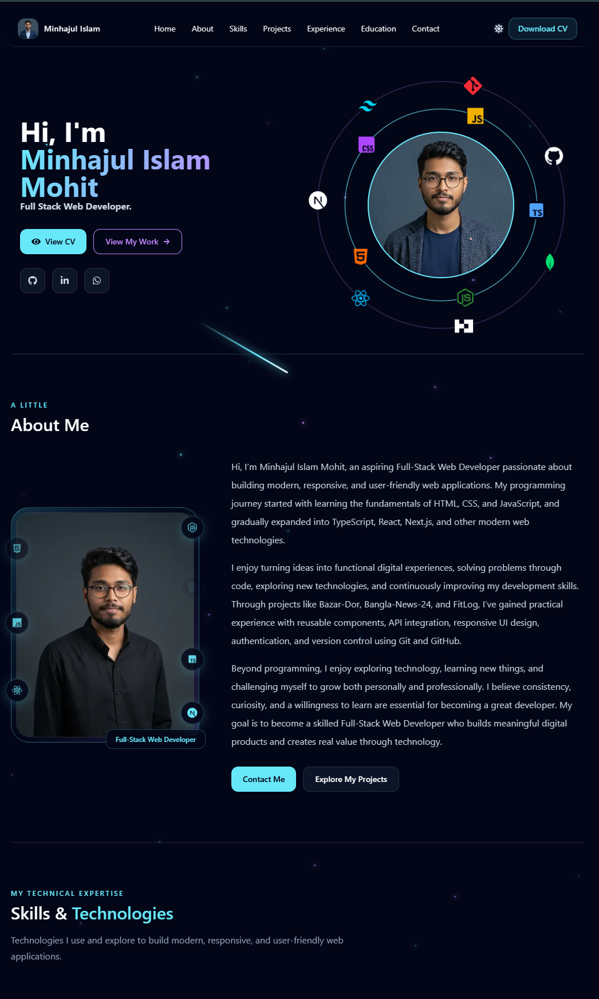

# Minhajul Islam Mohit — Portfolio


The personal portfolio website of **Minhajul Islam Mohit**, a Full-Stack Web Developer who builds modern, responsive web applications with React, Next.js, and TypeScript.

This site is a single place to explore my work: featured projects with dedicated case-study pages, my tech stack, experience, education, and a downloadable CV — wrapped in a fully custom, animated, multi-theme UI.

**🔗 Live site:** [minhajul-islam-portfolio-one.vercel.app](https://minhajul-islam-portfolio-one.vercel.app/)



## Features

- **Seven switchable themes** — from `dark-neon` and `cyberpunk` to `clean-light` and `mocha` — persisted in `localStorage` and applied to `<html>` before first paint (no flash). Cycle themes with the navbar button, the <kbd>T</kbd> key, or the resident dev pet.
- **DevPet easter egg** — an interactive pixel cat that walks along the page, follows your cursor, reacts to meteor animations, and doubles as a theme switcher.
- **Animated experience** — orbiting hero profile, floating particles, and scroll-reveal sections using CSS animations, all respecting `prefers-reduced-motion`.
- **Project case studies** — dynamic routes at `/projects/[slug]` with video previews, tech stacks, key features, challenges, and future plans.
- **CV page** — in-browser PDF preview with a direct download at `/cv`.
- **Direct message form** — contact section with quick-reach cards and a validated message form that delivers straight to my inbox through a Resend-powered Server Action.
- **Fully responsive & accessible** — mobile navigation, semantic sections, focus-visible states, and keyboard support throughout.
- **Analytics built in** — Vercel Analytics and Speed Insights integrated at the root layout.

## Tech Stack

| Layer      | Technology                                                                 |
| ---------- | -------------------------------------------------------------------------- |
| Framework  | [Next.js 16](https://nextjs.org) (App Router) with Turbopack               |
| UI         | [React 19](https://react.dev), [Tailwind CSS 4](https://tailwindcss.com), [react-icons](https://react-icons.github.io/react-icons/) |
| Language   | [TypeScript 5](https://www.typescriptlang.org)                             |
| Email      | [Resend](https://resend.com) via a Next.js Server Action                    |
| Fonts      | Geist Sans & Geist Mono via `next/font`                                    |
| Analytics  | [Vercel Analytics](https://vercel.com/analytics) & [Speed Insights](https://vercel.com/docs/speed-insights) |
| Deployment | [Vercel](https://vercel.com)                                               |

## Project Structure

```text
src/
├── app/
│   ├── layout.tsx         # Root layout: fonts, metadata, providers, analytics
│   ├── page.tsx           # Home page composing all sections
│   ├── globals.css        # Tailwind v4 theme tokens and per-theme styles
│   ├── actions/           # Server Actions (contact form → Resend)
│   ├── cv/page.tsx        # CV preview + download page
│   └── projects/[slug]/   # Dynamic project case-study pages
├── components/
│   ├── herosection/       # Hero with orbiting profile
│   ├── navsection/        # Sticky glass navigation and mobile menu
│   ├── sections/          # About, Skills, Projects, Experience, Education, Contact
│   ├── footersection/     # Footer
│   ├── projects/          # Project video preview player
│   ├── theme-provider.tsx # Theme state, switching, and persistence
│   ├── floatingparticles.tsx  # Animated background particles
│   ├── DevPet.tsx             # Interactive pixel-cat companion
│   └── reveal.tsx             # Scroll-reveal animation wrapper
└── data/
    └── projects.ts        # Single source of truth for project content

public/
├── asset/                 # Profile images and CV PDF
├── pets/                  # Cat sprite frames for DevPet
└── projects/<slug>/       # Project preview videos
```

## Contact form setup

The Direct Message form posts to a Server Action that sends email through [Resend](https://resend.com).

1. Create a Resend account and an API key.
2. Verify a sending domain (or use `onboarding@resend.dev` in test mode — it only delivers to the Resend account owner's email).
3. Copy `.env.example` to `.env.local` and fill in the values:

```bash
RESEND_API_KEY=re_...
RESEND_FROM_EMAIL="Portfolio Contact <contact@your-domain.com>"
CONTACT_TO_EMAIL=minhajul.mohit@gmail.com
```

4. Add the same variables in your Vercel project settings, then redeploy.

Without `RESEND_API_KEY` the form stays visible but shows a "not configured" message.

## Contact

- **Email:** [minhajul.mohit@gmail.com](mailto:minhajul.mohit@gmail.com)
- **GitHub:** [@minhajulmohit](https://github.com/minhajulmohit)
- **LinkedIn:** [md-minhajul-islam-mohit](https://www.linkedin.com/in/md-minhajul-islam-mohit/)

## License

© 2026 Minhajul Islam Mohit. All rights reserved.

This repository and its contents are published for viewing and demonstration purposes only. No part of the source code, design, text, images, or CV may be copied, modified, distributed, or reused in any form without prior written permission from the author. See the [LICENSE](LICENSE) file for full terms.
